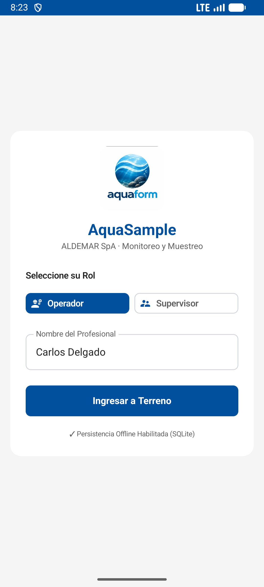
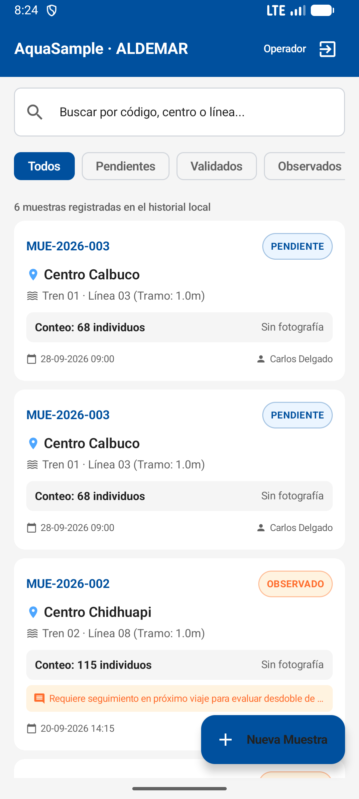
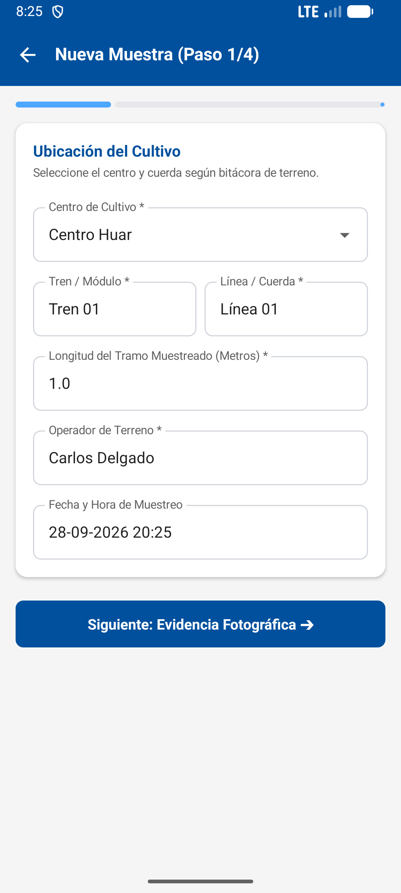

# AquaSample Mobile 🌊📱
### Industrial Aquaculture & Mussel Farming Traceability Platform

[](https://kotlinlang.org)
[-3DDC84.svg?logo=android)](https://developer.android.com)
[](https://developer.android.com/jetpack/compose)
[-orange.svg?logo=sqlite)](https://developer.android.com/training/data-storage/room)
[]()
[]()

---

## 📌 Executive Summary

**AquaSample** is an industrial-grade mobile application designed to digitize, standardize, and streamline the field sampling and traceability processes in the mussel aquaculture industry (*Mytilus chilensis*). 

Engineered for extreme outdoor conditions in the fjords and marine centers of southern Chile (Puerto Montt, Calbuco, Chiloé), the platform replaces manual paper logbooks and scattered WhatsApp photos with a unified, **100% Offline-First** digital workflow.

---

## 📸 App Showcase

<div align="center">
  
  &nbsp;&nbsp;&nbsp;
  
  &nbsp;&nbsp;&nbsp;
  
</div>

*Interfaces built from the ground up using Jetpack Compose and Material Design 3 tokens.*

---

## 🌊 The Real-World Problem & Solution

### The Challenge
In open-water aquaculture centers, field operators pull representative sections of cultivation ropes to perform biometric measurements (count, size distribution, biofouling, and predator presence). Currently, operators record notes in paper sheets and capture photos on personal smartphones:
- ❌ **Data fragmentation:** Photos get lost in messaging apps or galleries with no metadata.
- ❌ **Human counting errors:** Extreme conditions cause discrepancies in density and weight estimations.
- ❌ **Zero connectivity:** Marine pontoon locations in Patagonia have zero reliable 4G/WiFi.
- ❌ **Broken traceability:** Supervisors cannot easily track the historical growth curves of a specific line over months.

### The Solution: AquaSample
- 🛡️ **Offline-First Resilience:** Local SQLite storage via Room. All records, metrics, and photo links persist reliably on-device without internet access.
- 🏷️ **Rigorous Traceability:** Hierarchical metadata architecture: `Center ➔ Train/Module ➔ Line/Rope ➔ Sample`.
- 🧤 **Field-Ready Ergonomic UI:** Large high-contrast touch targets (+1, +10, +50 rapid counters) engineered for gloved operation on rolling boats.
- 🔍 **Quality Assurance (Supervisor Workflow):** Dedicated technical review screen allowing supervisors to validate or flag samples with technical corrective instructions.

---

## 🏗️ System Architecture

AquaSample strictly follows modern Android Architecture guidelines (**MVVM + Clean Architecture** layer separation):

```mermaid
flowchart TD
    subgraph UI Layer [UI Layer (Jetpack Compose + Material 3)]
        V1[LoginScreen]
        V2[HomeScreen / Historial]
        V3[Wizard: NewSample ➔ Photo ➔ Count ➔ Summary]
        V4[SupervisorReviewScreen]
    end

    subgraph State Management [State Layer (Reactive Flow)]
        VM1[AuthViewModel]
        VM2[SampleListViewModel]
        VM3[SampleCreateViewModel]
        VM4[SupervisorReviewViewModel]
    end

    subgraph Domain & Data Layer [Data Layer (Offline-First)]
        REPO[SampleRepository]
        DAO[SampleDao & CenterDao]
        ROOM[(Room SQLite Database: aquasample_aldemar.db)]
    end

    UI Layer -->|User Events| State Management
    State Management -->|StateFlow Emitters| UI Layer
    State Management -->|Coroutines / Suspend| REPO
    REPO -->|Flow Streams| State Management
    REPO --> DAO
    DAO --> ROOM
```

---

## ✨ Key Features & Engineering Highlights

* **4-Step Guided Wizard:**
  1. *Cultivation Location:* Center selector (pre-loaded with Patagonian centers), Train, Line, Section length ($1.0\text{ m}$), Operator and Timestamp.
  2. *Visual Evidence:* Gallery and Camera capture integration via Android `FileProvider`.
  3. *Ergonomic Counter:* High-contrast count visor with single-tap increments and notes field for biofouling or predators.
  4. *Technical Summary:* Pre-commit inspection card before SQLite insertion.
* **Reactive Multi-Filter Search:** Real-time query search coupled with status chips (`Todos`, `Pendientes`, `Validados`, `Observados`) using Kotlin Coroutines `combine()`.
* **Technical Quality Control:** Supervisors can inspect individual samples and apply **Validado** (Green `#2E7D32`) or **Observado** (Orange `#FF6D2D`) statuses with auditing notes.
* **Auto-Seeding Demo Database:** Automatically provisions initial cultivation centers (*Centro Huar*, *Centro Chidhuapi*, *Centro Calbuco*, *Centro Quellón*) and benchmark samples on first boot.

---

## 🛠️ Tech Stack & Dependencies

| Category | Technology |
| :--- | :--- |
| **Language** | Kotlin 2.0.21 |
| **UI Toolkit** | Jetpack Compose + Material 3 (`androidx.compose.material3`) |
| **Architecture** | MVVM (Model-View-ViewModel) + Repository Pattern |
| **Local Persistence** | AndroidX Room 2.6.1 SQLite + KSP |
| **Asynchronous Engine** | Kotlin Coroutines & Reactive `StateFlow` |
| **Navigation** | Jetpack Navigation Compose (`androidx.navigation:navigation-compose:2.8.3`) |
| **Image Loading** | Coil Compose (`io.coil-kt:coil-compose:2.7.0`) |
| **Target SDK** | Android 14 (API 34) · Min SDK: Android 7.0 (API 24) |

---

## 🚀 Getting Started

### Prerequisites
* **Android Studio** (Koala / Ladybug or newer).
* **JDK 17 or JDK 21**.
* Android Virtual Device (AVD) running API 24+ or a physical Android device with USB Debugging enabled.

### Installation
1. Clone this repository:
   ```bash
   git clone https://github.com/mathymj02/AquaSample-Mobile-App.git
   ```
2. Open Android Studio and select **File ➔ Open**.
3. Select the cloned folder.
4. Wait for Gradle Sync to resolve dependencies.
5. Hit **Run ▶️** (`Shift + F10`) to deploy to your emulator or physical smartphone.

---

## 👨‍💻 Author

**Matías Mena**  
*Computer Science & Mobile / Backend Engineering Student*  
*Duoc UC · Puerto Montt, Chile*  

* **GitHub:** [@mathymj02](https://github.com/mathymj02)  
* **Email:** [ma.menaj@duocuc.cl](mailto:ma.menaj@duocuc.cl)

---

## 📄 License

This project is licensed under the **MIT License** — feel free to inspect, modify, and build upon it.
